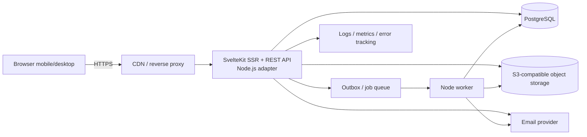
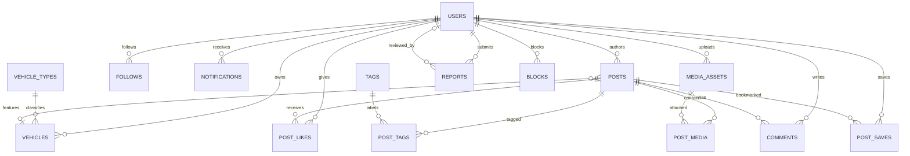

# GIsland Technical Blueprint
## Bộ tài liệu yêu cầu và thiết kế kỹ thuật

**Phiên bản:** 1.0 · **Ngày:** 24/11/2026 · **Ngôn ngữ:** Tiếng Việt  
**Định hướng:** Portfolio full-stack · Web responsive · SvelteKit + Node.js + PostgreSQL

## 1. Tóm tắt quyết định

GIsland là mạng xã hội web cho cộng đồng chơi **mọi loại phương tiện**: xe máy, ô tô, xe đạp, xe tải, xe địa hình, xe điện, phương tiện cổ điển và các nhóm liên quan. Trải nghiệm cốt lõi là hồ sơ người chơi và gara phương tiện, bài đăng đa phương tiện, tương tác, theo dõi, khám phá cộng đồng và kiểm duyệt minh bạch. MVP tập trung vào vòng lặp “đăng xe/bài → khám phá → tương tác → theo dõi”; không đưa chat, livestream, thương mại điện tử hay thuật toán gợi ý phức tạp vào phạm vi 16 tuần.

Thiết kế khởi đầu dùng **modular monolith**: một ứng dụng SvelteKit chạy trên Node.js, một PostgreSQL, object storage tương thích S3 cho ảnh và một worker nhẹ cho tác vụ nền. API REST có versioning, schema OpenAPI và cursor pagination. Tách dịch vụ chỉ khi đo đạc chứng minh cần thiết.

### Mục tiêu sản phẩm

- Tạo hồ sơ cá nhân và bộ sưu tập phương tiện có cấu trúc dùng chung cho nhiều thể loại.
- Xuất bản bài viết kèm ảnh, gắn phương tiện, hashtag và danh mục.
- Theo dõi người dùng, thích, bình luận, lưu bài và xem feed theo thời gian.
- Khám phá theo thể loại xe, hãng/dòng xe, địa điểm và hashtag.
- Báo cáo nội dung, kiểm duyệt bằng vai trò moderator/admin và lưu dấu vết hành động.
- Có trải nghiệm responsive, truy cập được bằng bàn phím, và trang công khai có metadata SEO.

### Ngoài phạm vi MVP

Chat realtime, hội nhóm có quyền thành viên nâng cao, sự kiện/đi tour, marketplace/giao dịch, thanh toán, livestream, ứng dụng native, định vị thời gian thực, recommendation ML, xác minh danh tính và quảng cáo trả phí. Các mục này được đặt ở các giai đoạn sau.

## 2. Bối cảnh và giả định

TrollXe hiện thể hiện cách tổ chức nội dung theo chuyên mục, nội dung cộng đồng và khu vực khám phá; GIsland tham khảo mô hình khám phá nội dung nhưng xây sản phẩm xã hội xoay quanh nhiều loại phương tiện thay vì tập trung một loại xe. Đây là phân tích bề mặt trang công khai, không phải đánh giá nội bộ hay sao chép nội dung. Nguồn: [TrollXe](https://trollxe.vn/).

Giả định phiên bản đầu nhắm tới người dùng Việt Nam; giao diện tiếng Việt, múi giờ hiển thị Asia/Ho_Chi_Minh, lưu thời gian UTC. Tên miền, nhà cung cấp cloud, chính sách lưu media và quy định pháp lý cần được xác nhận trước khi phát hành thật. Các lựa chọn công nghệ là đề xuất thiết kế cho portfolio, không phải yêu cầu vận hành ở quy mô lớn.

## 3. SRS – Software Requirements Specification

### 3.1 Phạm vi và định nghĩa

**Người dùng:** khách, thành viên, moderator, admin.  
**Phương tiện:** một bản ghi xe/vehicle có `vehicle_type` từ danh mục cấu hình được; trường riêng theo loại xe nằm trong JSONB có kiểm soát schema, thuộc tính chung nằm ở cột quan hệ.  
**Bài đăng:** nội dung văn bản kèm 0–10 ảnh, có thể gắn một phương tiện; giới hạn MVP 3.000 ký tự.  
**Feed:** danh sách bài công khai từ người theo dõi và bài khám phá mới nhất; sắp xếp thời gian, không cá nhân hóa ML.

### 3.2 Vai trò và quyền

| Vai trò | Quyền chính |
|---|---|
| Khách | Xem hồ sơ/bài công khai, tìm kiếm, đăng ký/đăng nhập |
| Thành viên | Quản lý hồ sơ và phương tiện; tạo/sửa/xóa nội dung của mình; tương tác; báo cáo; chặn người dùng |
| Moderator | Xem hàng chờ báo cáo; ẩn/khôi phục nội dung; ghi lý do xử lý; không quản trị tài khoản admin |
| Admin | Quản lý danh mục, vai trò, người dùng và cấu hình; xem audit log |

Quyền được kiểm tra ở server cho mỗi request. Không tin cậy trạng thái giao diện hoặc ID do client gửi.

### 3.3 Yêu cầu chức năng

| ID | Yêu cầu | Mức | Tiêu chí nghiệm thu |
|---|---|---|---|
| FR-01 | Đăng ký, đăng nhập, đăng xuất, xác minh email, quên/đặt lại mật khẩu | MVP | Email duy nhất; token đặt lại dùng một lần, hết hạn; phản hồi không tiết lộ email có tồn tại |
| FR-02 | Hồ sơ: username, tên hiển thị, bio, avatar, khu vực, liên kết | MVP | Username duy nhất, slug an toàn; hồ sơ công khai hiển thị đúng trạng thái riêng tư |
| FR-03 | CRUD phương tiện trong gara cá nhân | MVP | Bắt buộc loại xe, tên; hỗ trợ hãng, mẫu, năm, mô tả, ảnh; chỉ chủ sở hữu sửa/xóa |
| FR-04 | Bài đăng văn bản, ảnh, phương tiện gắn kèm, hashtag | MVP | 0–10 media; xác thực loại/kích thước; trạng thái draft/published/hidden/deleted |
| FR-05 | Feed công khai và feed theo dõi | MVP | Cursor pagination ổn định; loại nội dung đã ẩn, đã xóa, bị chặn |
| FR-06 | Thích/bỏ thích, bình luận, sửa/xóa bình luận của mình, lưu/bỏ lưu bài | MVP | Mỗi người một like/save mỗi đối tượng; thao tác idempotent; đếm nhất quán |
| FR-07 | Theo dõi/bỏ theo dõi và trang người theo dõi | MVP | Không tự theo dõi; chống bản ghi trùng; số liệu có thể tính lại |
| FR-08 | Tìm kiếm người dùng, bài, phương tiện; lọc loại xe/hashtag | MVP | Tối thiểu tìm theo tên/bio/tiêu đề; có giới hạn và thứ tự xác định |
| FR-09 | Báo cáo bài/bình luận/tài khoản và hàng chờ moderator | MVP | Có lý do, trạng thái xử lý, người xử lý và lịch sử quyết định |
| FR-10 | Chặn người dùng | MVP | Hai bên không thấy nội dung/tương tác của nhau; chặn có hiệu lực phía server |
| FR-11 | Thông báo trong ứng dụng cho follow/like/comment | MVP | Tạo qua transaction/outbox; đọc/chưa đọc; không tự thông báo cho chính mình |
| FR-12 | Admin quản lý danh mục vehicle type/brand và vai trò | MVP | Mọi thay đổi phân quyền có audit log |
| FR-13 | Hội nhóm theo chủ đề/loại xe, quản trị thành viên | Phase 2 | Nhóm public/private, owner/moderator, membership states |
| FR-14 | Sự kiện, chuyến đi, RSVP, điểm tập trung | Phase 2 | Có timezone, trạng thái hủy, hạn chế lộ vị trí chính xác |
| FR-15 | Chat, realtime, upload video, marketplace | Phase 3 | Thiết kế riêng threat model, chi phí và quy trình xử lý giao dịch |

### 3.4 Yêu cầu phi chức năng

- **Hiệu năng mục tiêu MVP:** p95 API đọc ≤ 500 ms và ghi ≤ 800 ms trên môi trường staging với dữ liệu mẫu 10k người dùng/100k bài; loại trừ thời gian tải media ngoài.
- **Tải trang:** LCP mục tiêu ≤ 2.5 giây trên mạng di động mô phỏng cho trang feed có ảnh tối ưu; ảnh dùng responsive sizes/lazy loading.
- **Khả dụng:** mục tiêu portfolio 99.5% theo tháng khi có hosting phù hợp; lỗi ứng dụng phải có request ID và log cấu trúc.
- **Bảo mật:** HTTPS, cookie phiên HttpOnly/Secure/SameSite, CSRF protection, kiểm tra quyền server-side, rate limiting cho xác thực và ghi dữ liệu.
- **Khả năng truy cập:** điều hướng bàn phím, focus rõ, nhãn biểu mẫu, alt text ảnh; mục tiêu WCAG 2.2 AA cho luồng cốt lõi.
- **Tương thích:** hai phiên bản chính gần nhất của Chrome, Edge, Firefox, Safari; viewport 360px trở lên.
- **Sao lưu:** backup PostgreSQL hàng ngày trong môi trường demo; diễn tập khôi phục trước release. Mục tiêu RPO 24 giờ/RTO 8 giờ cho portfolio.
- **Quyền riêng tư:** chỉ thu dữ liệu cần thiết; chức năng xuất/xóa tài khoản trong giai đoạn 2 hoặc trước khi vận hành thương mại.

## 4. Kiến trúc hệ thống

### 4.1 Sơ đồ triển khai



### 4.2 Lựa chọn kiến trúc

SvelteKit đảm nhiệm SSR, trang công khai thân thiện SEO và các route REST `/api/v1`. Dùng `@sveltejs/adapter-node` để tạo Node server; tài liệu chính thức mô tả adapter này là lựa chọn cho Node server ([SvelteKit adapters](https://svelte.dev/docs/kit/adapters)). Node app chia thành module theo miền: auth, users, vehicles, posts, social, search, moderation, notifications. Controller/route chỉ xử lý HTTP; service giữ quy tắc nghiệp vụ; repository/ORM quản lý truy vấn và transaction.

PostgreSQL là nguồn dữ liệu chuẩn. Dữ liệu có cấu trúc nằm trong bảng quan hệ; JSONB chỉ dùng cho thuộc tính chuyên biệt theo phương tiện, được kiểm tra theo loại và không dùng thay quan hệ. PostgreSQL hỗ trợ JSONB và chỉ mục cho truy vấn JSON ([PostgreSQL JSON types](https://www.postgresql.org/docs/current/datatype-json.html)). Ảnh lưu ngoài DB; database lưu key, MIME, kích thước, checksum và trạng thái xử lý. Không lưu URL public cố định nếu cần quyền truy cập.

**MVP không cần microservices.** Outbox table tạo việc nền bền vững trong cùng transaction. Worker riêng có thể chạy cùng image/deploy; queue bên ngoài chỉ thêm khi nhu cầu xuất hiện. Cache Redis, search engine, CDN tùy biến và read replica để sau khi đo bottleneck.

### 4.3 Luồng upload ảnh

1. Client gọi `POST /media/upload-intents` với tên, MIME, byte size, checksum.
2. Server xác thực phiên, quota, extension/MIME allowlist và giới hạn kích thước; trả URL ký tạm hoặc đường upload proxy.
3. Client upload trực tiếp storage; server xác minh object/metadata, trạng thái ban đầu `pending`.
4. Worker kiểm tra magic bytes, quét malware nếu khả dụng, giải mã/re-encode ảnh, tạo thumbnail và xóa metadata EXIF nhạy cảm.
5. Chỉ media `ready` mới gắn vào bài viết. URL xem được ký ngắn hạn hoặc qua CDN policy.

### 4.4 Cấu trúc mã nguồn đề xuất

```text
src/lib/server/{auth,db,modules,security,storage,validation}/
src/routes/(public)/...
src/routes/(app)/...
src/routes/api/v1/...
db/migrations/
openapi/gisland-v1.yaml
tests/{unit,integration,e2e}/
```

## 5. Mô hình dữ liệu và ERD

### 5.1 Quy ước

PK UUID; thời gian `timestamptz` UTC; soft delete cho user/post khi cần khôi phục; enum dùng CHECK hoặc bảng danh mục để thay đổi dễ dàng. Mọi bảng nghiệp vụ có `created_at`, các bảng có thể sửa có `updated_at`. Dùng unique constraints và foreign keys thay cho kiểm tra ứng dụng đơn thuần.

### 5.2 ERD mức logic



### 5.3 Từ điển bảng

| Bảng | Trường cốt lõi và quy tắc |
|---|---|
| users | id, email_normalized unique, password_hash, username unique, display_name, bio, avatar_media_id, role, status, email_verified_at, created_at, deleted_at |
| user_profiles | user_id PK/FK, location_text, website_url, privacy enum, preferences JSONB giới hạn schema |
| vehicle_types | id, slug unique, name, active, sort_order; seed motorcycle/car/bicycle/truck/offroad/electric/classic/other |
| vehicles | id, owner_id, vehicle_type_id, title, make, model, year CHECK, description, attributes JSONB, visibility, created_at, updated_at, deleted_at |
| media_assets | id, owner_id, storage_key unique, mime_type, byte_size, width, height, checksum, status, alt_text, created_at |
| posts | id, author_id, vehicle_id nullable, body, visibility, status, comments_enabled, published_at, created_at, updated_at, deleted_at |
| post_media | post_id, media_id, position; PK(post_id,media_id), unique(post_id,position) |
| tags | id, slug unique, display_name |
| post_tags | post_id, tag_id; composite PK |
| follows | follower_id, followee_id, created_at; composite PK, CHECK self-follow |
| post_likes | user_id, post_id, created_at; composite PK |
| post_saves | user_id, post_id, created_at; composite PK |
| comments | id, post_id, author_id, parent_id nullable, body, status, created_at, updated_at, deleted_at; MVP chỉ cho một cấp trả lời hoặc giới hạn depth=1 |
| blocks | blocker_id, blocked_id, created_at; composite PK, CHECK self-block |
| reports | id, reporter_id, target_type, target_id, reason_code, details, status, assigned_to, resolution, resolved_at, created_at |
| notifications | id, recipient_id, actor_id, type, entity_type, entity_id, read_at, created_at; unique dedupe key tùy event |
| outbox_events | id, event_type, aggregate_id, payload JSONB, available_at, processed_at, attempts, created_at |
| audit_logs | id, actor_id, action, target_type, target_id, reason, metadata JSONB, created_at; append-only |

### 5.4 Chỉ mục quan trọng

- `posts(status, visibility, published_at DESC, id DESC)` cho feed mới nhất.
- `posts(author_id, published_at DESC)` cho trang cá nhân.
- `vehicles(owner_id, created_at DESC)`; `vehicles(vehicle_type_id, make, model)` cho lọc.
- `comments(post_id, created_at, id)`; `notifications(recipient_id, read_at, created_at DESC)`.
- `follows(follower_id, created_at DESC)` và chỉ mục đảo `follows(followee_id)`.
- GIN trên `to_tsvector('simple', body)` hoặc cột search vector được duy trì; GIN trên JSONB chỉ khi truy vấn thực tế cần.
- Mọi FK hay lọc theo ownership thường dùng đều được đánh giá chỉ mục bằng query plan trước release.

## 6. API Specification

### 6.1 Quy ước chung

Base path `/api/v1`; JSON UTF-8; UUID; ngày giờ ISO-8601 UTC. Danh sách dùng cursor opaque: `?limit=20&cursor=...`, limit tối đa 50. Thành công trả JSON resource; lỗi dùng `application/problem+json` với `type`, `title`, `status`, `detail`, `requestId`, `fieldErrors`. Dùng status chuẩn 200/201/204/400/401/403/404/409/422/429. `Idempotency-Key` hỗ trợ tạo bài và upload intent nếu retry có thể tạo trùng. API đầy đủ máy đọc được nằm trong `GIsland-OpenAPI.yaml`.

### 6.2 Endpoint MVP

| Method | Path | Auth | Mô tả |
|---|---|---|---|
| POST | /auth/register | Public | Tạo tài khoản và gửi xác minh |
| POST | /auth/login | Public | Tạo session cookie |
| POST | /auth/logout | Member | Thu hồi session |
| POST | /auth/forgot-password | Public | Gửi link đặt lại, phản hồi chống dò tài khoản |
| POST | /auth/reset-password | Public | Đổi mật khẩu bằng token một lần |
| GET/PATCH | /me | Member | Đọc/cập nhật hồ sơ của mình |
| GET | /users/{username} | Optional | Hồ sơ công khai |
| GET/POST | /me/vehicles | Member | Danh sách/tạo phương tiện |
| GET/PATCH/DELETE | /vehicles/{vehicleId} | Optional/Owner | Đọc/sửa/xóa mềm phương tiện |
| POST | /media/upload-intents | Member | Xin quyền upload |
| GET/POST | /posts | Optional/Member | Feed công khai hoặc tạo bài |
| GET/PATCH/DELETE | /posts/{postId} | Optional/Author | Đọc/sửa/xóa bài |
| PUT/DELETE | /posts/{postId}/like | Member | Thích/bỏ thích idempotent |
| PUT/DELETE | /posts/{postId}/save | Member | Lưu/bỏ lưu |
| GET/POST | /posts/{postId}/comments | Optional/Member | Đọc/tạo bình luận |
| PATCH/DELETE | /comments/{commentId} | Author/Mod | Sửa/xóa/ẩn bình luận |
| PUT/DELETE | /users/{userId}/follow | Member | Theo dõi/bỏ theo dõi |
| PUT/DELETE | /users/{userId}/block | Member | Chặn/bỏ chặn |
| GET | /feed/following | Member | Feed người theo dõi |
| GET | /search | Optional | Tìm user/post/vehicle với type/filter |
| POST | /reports | Member | Gửi báo cáo |
| GET/PATCH | /moderation/reports | Moderator | Danh sách và xử lý báo cáo |
| GET/PATCH | /notifications | Member | Danh sách/đánh dấu đã đọc |

### 6.3 Mẫu payload và lỗi

Tạo bài:

```json
{
  "body": "Hoàn thiện chiếc xe sau một mùa touring.",
  "vehicleId": "7b2b4e2a-8fb2-4a0f-a07c-3f0ea8c2b682",
  "mediaIds": ["a66c1eaa-f7d7-46bb-8e99-a57b27159df1"],
  "tags": ["touring", "build-log"],
  "visibility": "public"
}
```

Lỗi validation:

```json
{
  "type": "https://gisland.example/problems/validation",
  "title": "Dữ liệu không hợp lệ",
  "status": 422,
  "requestId": "req_01J...",
  "fieldErrors": [{"field": "body", "code": "max_length", "message": "Tối đa 3000 ký tự."}]
}
```

Feed dùng keyset `(published_at, id)`; cursor được ký/mã hóa và không cho client tự chọn điều kiện SQL. Sort có thứ tự ổn định; dữ liệu bị xóa/ẩn hoặc bị block được lọc trước serialize.

## 7. Bảo mật và quyền riêng tư

1. **Xác thực:** Argon2id hoặc bcrypt với cost phù hợp; session ngẫu nhiên lưu hash trong DB; cookie HttpOnly, Secure, SameSite=Lax; xoay session sau login/đổi quyền; MFA admin là mục tiêu trước production.
2. **Phân quyền:** RBAC cộng ownership checks trong service. Kiểm tra quyền với mọi ID tài nguyên để chặn IDOR; moderator action yêu cầu reason và audit log.
3. **CSRF/XSS:** CSRF token hoặc kiểm tra Origin cho mutation cookie-auth; escape nội dung khi render; không render HTML người dùng; Content Security Policy; output encoding theo ngữ cảnh.
4. **Injection:** truy vấn tham số hóa; schema validation ở biên; allowlist sort/filter; không nối chuỗi SQL từ input.
5. **Abuse:** rate limit đăng nhập, đăng ký, reset password, comment, report và upload; captcha chỉ khi có tín hiệu abuse; chống spam và giới hạn tần suất.
6. **Media:** giới hạn byte/pixel, xác thực magic bytes, re-encode, loại EXIF GPS, tên object ngẫu nhiên, không chạy file, signed URLs ngắn hạn.
7. **Secrets/ops:** secrets từ biến môi trường/secret manager, không commit; TLS DB, least privilege; backup mã hóa; cập nhật dependency; log không chứa mật khẩu/token/private payload.
8. **Quyền riêng tư:** công khai theo mặc định chỉ với bài/hồ sơ được chọn; phương tiện có visibility; block được áp dụng xuyên feed/search/profile; quy trình yêu cầu xóa và retention được chốt trước khi mở công khai.

Threat review trước release: account takeover, credential stuffing, IDOR, stored XSS, CSRF, spam, upload polyglot, scraping, lộ vị trí EXIF, moderator abuse, mass assignment, notification enumeration, backup exposure.

## 8. Testing và tiêu chí chất lượng

Không coi kiểm thử là bước sau cùng; mỗi tính năng có acceptance tests. Tổ chức test:

- **Unit:** validation, quyền sở hữu, rule visibility/block, cursor encode/decode, business service.
- **Integration:** migrations trên PostgreSQL thật, transaction, unique constraints, upload metadata, outbox, query moderation.
- **Contract:** OpenAPI lint; payload/response schema và status khớp implementation.
- **E2E:** đăng ký/login; tạo gara và bài; follow/feed; like/comment/save; report/moderate; responsive viewport.
- **Security:** dependency audit, ZAP baseline hoặc kiểm tra tương đương trên staging, kiểm tra IDOR và rate limit; secret scan.
- **Accessibility:** kiểm tra tự động và rà thủ công keyboard/focus/labels/contrast cho luồng chính.
- **Performance:** seed dataset đã nêu; đo p95 feed, hồ sơ, search; kiểm tra ảnh lazy load và kích thước bundle.

**Definition of Done:** yêu cầu có acceptance criteria đạt; migration có rollback/forward plan; OpenAPI cập nhật; phân quyền được test; không có lỗi severity cao chưa xử lý; telemetry/log hoạt động; giao diện responsive và keyboard; tài liệu vận hành cập nhật.

## 9. Roadmap 16 tuần

Giả định một người làm full-stack, 5 ngày/tuần, có review định kỳ. Mỗi tuần tạo một mốc chạy được; phạm vi co giãn bằng thứ tự ưu tiên, không bỏ kiểm tra quyền và luồng cốt lõi.

| Tuần | Trọng tâm | Bàn giao và cổng nghiệm thu |
|---|---|---|
| 1 | Product discovery, personas, user journeys, feature cut | PRD/SRS baseline; MVP và non-goals được khóa |
| 2 | Wireframe responsive, design tokens, data dictionary, threat model | Luồng feed/profile/garage/post/moderation được review |
| 3 | Repo, SvelteKit, Node adapter, PostgreSQL, migrations, CI | App chạy local/staging; health check; CI build |
| 4 | Auth/session, email verification, password reset | Luồng auth E2E; rate limits và cookie flags |
| 5 | Profile, privacy, vehicle type taxonomy, garage CRUD | Loại phương tiện đa dạng; ownership tests |
| 6 | Media upload intent/storage pipeline, image processing | Upload ảnh an toàn, quota và trạng thái ready |
| 7 | Post CRUD, media ordering, tags, vehicle linking | Tạo/sửa/xóa bài; schema/OpenAPI đồng bộ |
| 8 | Public feed, profile feed, pagination, SEO | Cursor ổn định, SSR và metadata |
| 9 | Follow, likes, saves, comments | Unique/idempotency; transaction và feed rules |
| 10 | Search, filters, block, notification outbox | Tìm theo nội dung/loại xe; block áp dụng server |
| 11 | Report queue, moderator/admin tools, audit | Moderator xử lý có reason; audit log append-only |
| 12 | Hoàn thiện UI responsive, accessibility, empty/error states | Rà luồng mobile/keyboard; WCAG checklist |
| 13 | Integration/E2E/security tests, seed/demo content | Không còn lỗi nghiêm trọng; test dữ liệu chuẩn |
| 14 | Performance, query/index tuning, observability | p95 mục tiêu đạt trên staging hoặc có kế hoạch xử lý |
| 15 | UAT, bug bash, backup/restore, privacy review | Checklist release ký nhận; rollback rehearsal |
| 16 | Deploy portfolio, demo script, README, case study | Release candidate, URL demo, sơ đồ và quyết định kỹ thuật |

### Cổng phát hành MVP

- Thành viên hoàn tất được hành trình: đăng ký → tạo profile → thêm phương tiện bất kỳ → đăng ảnh/bài → được khám phá → người khác tương tác.
- Không thể sửa/xóa tài nguyên người khác bằng cách đổi ID; block và ẩn nội dung được áp dụng mọi endpoint.
- Tệp media không được publish trước khi kiểm tra; dữ liệu bài bị xóa/ẩn không lọt vào feed/search.
- API docs, ERD, migration và seed data nhất quán; backup khôi phục được; lỗi có request ID.

## 10. Mở rộng theo giai đoạn

**Phase 2 (sau MVP):** hội nhóm, sự kiện/chuyến đi, thông báo email tùy chọn, trang garage công khai, album, export/xóa tài khoản, bộ lọc tìm kiếm nâng cao, nội dung được ghim.  
**Phase 3:** chat realtime có chống spam và retention; video/transcoding; marketplace ở chế độ listing trước rồi mới giao dịch; xác minh garage/brand; recommendation dựa trên tín hiệu minh bạch.  
**Phase 4:** mobile app/PWA nâng cao, analytics cộng đồng, nhiều ngôn ngữ, mở rộng vùng lưu trữ. Mỗi giai đoạn cần xem lại privacy, moderation load, chi phí media và mô hình abuse.

## 11. Rủi ro và cách xử lý

| Rủi ro | Tác động | Giảm thiểu |
|---|---|---|
| Phạm vi “mọi loại xe” làm taxonomy phình to | Form khó dùng, schema cứng | Core fields chung + vehicle_types + thuộc tính JSONB có schema; cho phép “khác” |
| Nội dung rỗng khi ra mắt | Feed kém hấp dẫn | Seed dữ liệu demo có nhãn, mời nhóm người dùng thử, demo script portfolio |
| Upload ảnh phát sinh chi phí/lỗ hổng | Tốn tiền, rủi ro file | Quota, giới hạn kích thước, re-encode, storage lifecycle, signed URL |
| Một người không hoàn tất toàn bộ | Trễ roadmap | MVP ưu tiên luồng vòng lặp; chat/video/marketplace bỏ khỏi 16 tuần |
| Chỉ mục/tìm kiếm chưa đủ khi dữ liệu tăng | Feed/search chậm | Đo query, index Postgres; chuyển search engine chỉ khi cần |
| Moderation tốn công | Spam/nội dung xấu | Report queue, block, rate limit, reason/audit; chính sách rõ |

## 12. Nguồn tham khảo

- TrollXe, trang công khai và cấu trúc chuyên mục: https://trollxe.vn/ (truy cập 24/11/2026).
- SvelteKit, Adapters: https://svelte.dev/docs/kit/adapters (truy cập 24/11/2026).
- SvelteKit, Node adapter: https://svelte.dev/docs/kit/adapter-node (tham khảo cách triển khai Node; URL docs có thể chuyển hướng theo phiên bản).
- PostgreSQL, JSON Types: https://www.postgresql.org/docs/current/datatype-json.html (truy cập 24/11/2026).
- OWASP Cheat Sheet Series: https://cheatsheetseries.owasp.org/ (nguồn hướng dẫn thực hành để xây checklist bảo mật).

## Phụ lục A. Quyết định thiết kế cần giữ nhất quán

1. Tất cả loại phương tiện dùng cùng `vehicles` và `vehicle_types`; không tạo bảng riêng cho motorcycle/car trong MVP.
2. Like/save/follow là quan hệ với unique key, không là bộ đếm độc lập; counter cache (nếu có) chỉ là dữ liệu dẫn xuất.
3. Visibility/status được kiểm tra phía server trước feed/search/API serialization.
4. Tệp media tách khỏi PostgreSQL; chỉ media `ready` được gắn bài.
5. REST API versioned và OpenAPI là hợp đồng; thay đổi breaking phải tăng version hoặc có migration.

