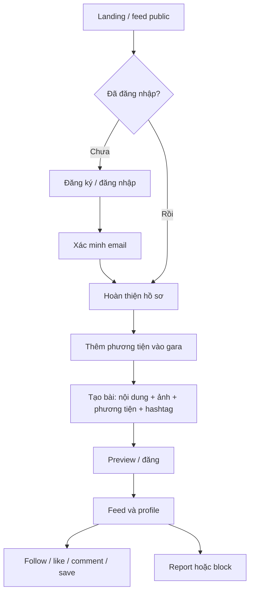

# GIsland — Luồng UX và trạng thái màn hình

Tài liệu này xác định luồng và trạng thái tối thiểu cho wireframe/prototype. API và quyền vẫn được định nghĩa ở Blueprint/OpenAPI; đây không phải nguồn để frontend tự suy ra authorization.

## Luồng chính của thành viên



## Các luồng theo màn hình

| Màn hình/luồng | Thành công | Trạng thái bắt buộc | Ghi chú |
|---|---|---|---|
| Public feed | Xem bài mới và mở chi tiết/profile | Loading, rỗng, lỗi tải, hết trang | Chỉ hiện public/visible; cursor pagination. |
| Đăng ký/đăng nhập | Tạo session và quay lại trang cần thiết | Validation, email đã dùng, rate limited, xác thực thất bại | Thông điệp không làm lộ việc email có tài khoản ở luồng reset. |
| Hồ sơ | Xem và cập nhật profile | Private/not found, loading, save success/failure | Nút follow/report/block tùy viewer/session; server xác thực lại. |
| Gara | Xem/tạo/sửa/xóa phương tiện | Gara rỗng, validation, upload lỗi, quyền từ chối | Form chung + field tùy loại phương tiện đã xác nhận. |
| Tạo bài | Upload, chọn phương tiện/tag, publish | Draft/local state, upload pending/transport error, media processing/rejected, validation, publish failure | Chỉ media ready mới publish; hiện thứ tự ảnh và remove/retry. |
| Chi tiết bài | Xem ảnh/nội dung và tương tác | Bài bị ẩn/xóa, không quyền xem, comment rỗng/lỗi | Không phân biệt lỗi theo cách làm lộ bài riêng tư. |
| Following feed | Đọc bài từ tài khoản theo dõi | Chưa follow ai, loading, lỗi, pagination | Chặn/lọc theo privacy và block ở server. |
| Search | Tìm người/bài/phương tiện | Chưa nhập, không có kết quả, lỗi, giới hạn | Filter loại xe/tag; debounce ở UI nhưng server vẫn rate limit. |
| Notifications | Đọc/đánh dấu đã xem | Inbox rỗng, lỗi, unread/read | Entity không xem được thì không lộ nội dung qua preview. |
| Report/moderation | Báo cáo; moderator xử lý có lý do | Submit success/failure; queue empty; stale/đã xử lý | UI moderator chỉ dành cho role; backend enforce mọi thao tác. |

## Wireframe sơ bộ (MVP)

Đây là bố cục mức low-fidelity để bắt đầu prototype; chưa phải quyết định về màu sắc/brand. Desktop và mobile dùng cùng thứ bậc nội dung, đổi cách điều hướng và bố cục theo viewport.

### Feed — desktop

```text
+--------------------------------------------------------------------------------+
| GIsland | Search __________________ | Explore | Notifications | Avatar/Menu   |
+------------------+---------------------------------+---------------------------+
| Navigation       | Create post (member)            | Suggested people/tags     |
| - Home            |---------------------------------|                           |
| - Following       | [Avatar] Name · time            | Trending vehicle types    |
| - Search          | Post text                        |                           |
| - Garage          | [image / media gallery]         | Suggested profiles        |
| - Saved           | Vehicle · #tags                 |                           |
| - Profile         | Like · Comment · Save · Report  |                           |
|                  | [next post ...]                  |                           |
+------------------+---------------------------------+---------------------------+
```

### Feed — mobile

```text
+----------------------------------+
| GIsland                 Search   |
| [For you] [Following]             |
|----------------------------------|
| Avatar Name · time        ...    |
| Post text                         |
| [full-width image/gallery]        |
| Vehicle · #tags                   |
| Like       Comment       Save     |
|----------------------------------|
| ...                               |
+----------------------------------+
| Home | Search | Create | Alerts | Me |
+----------------------------------+
```

### Profile và gara

```text
Profile header: avatar, display name, @username, bio, location/link
Actions: Follow/Following · Message (out of MVP; omit) · More (Report/Block)
Stats: posts · followers · following
Tabs: Posts | Garage
Garage card: image · vehicle title · type/make/model/year · visibility
Owner actions: Add vehicle · Edit · Delete (confirm)
```

### Tạo bài

```text
Create post
  Text area (0/3000)
  Add photos (0/10) → preview/order/remove/retry upload
  Attach vehicle (optional; pick from own garage)
  Add hashtags
  Visibility selector
  [Save draft] [Publish]
  Inline validation + per-file upload status
```

### Moderation queue

```text
Filters: Open | Assigned | Resolved       Sort: Oldest first
Report row: reason · target type · created time · report count
Detail: target preview + report details + reporter context (minimum needed)
Actions: Assign · Hide/restore · Resolve/dismiss
Required: moderator reason; audit event shown after action
```

### Design checks cần làm tiếp

- Vẽ wireframe trực quan cho empty/loading/error và breakpoint mobile/desktop.
- Chốt điều hướng create post trên mobile và nội dung public khi chưa login.
- Rà thao tác report/block để tránh đặt destructive action cạnh like/comment.
- Kiểm tra focus order, contrast, labels và alt text khi có prototype.

## Nguyên tắc UX xuyên suốt

- Thiết kế mobile-first từ viewport 360 px trở lên; điều hướng và form usable trên desktop.
- Mọi form có label, validation message gắn với trường, thông báo submit và giữ dữ liệu khi lỗi có thể sửa.
- Tương tác bất đồng bộ có pending state, chống submit lặp ở UI và phản hồi idempotent ở API khi phù hợp.
- Confirmation dùng cho hành động khó đảo ngược; xóa nội dung ưu tiên soft delete nếu đặc tả quy định.
- Keyboard focus rõ, thứ tự tab hợp lý, dialog giữ/trả focus, ảnh có alt phù hợp; không chỉ dùng màu để truyền trạng thái.
- Trạng thái 401/403/404/409/422/429/5xx hiển thị theo ý nghĩa đã thống nhất, không render raw exception.

